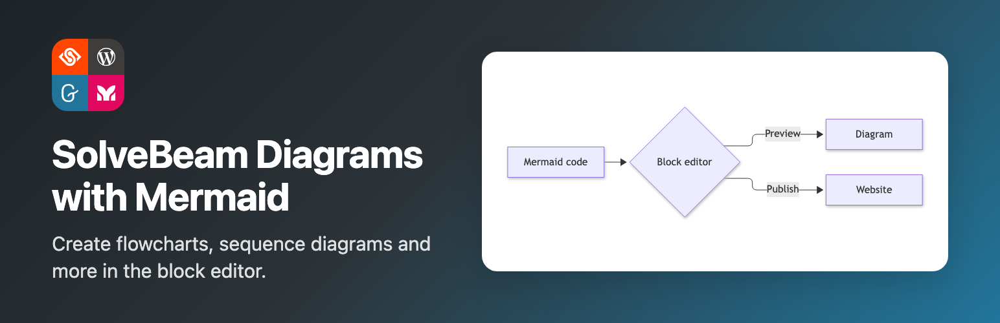
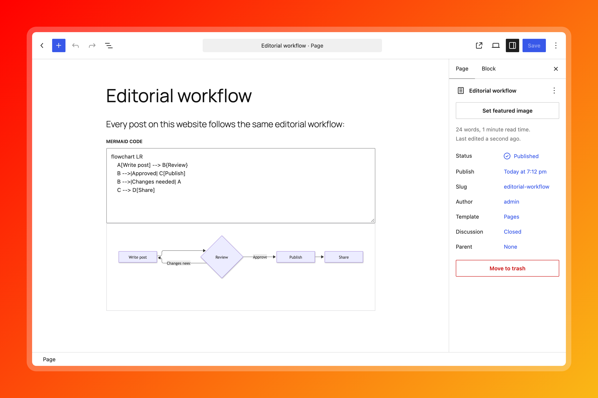
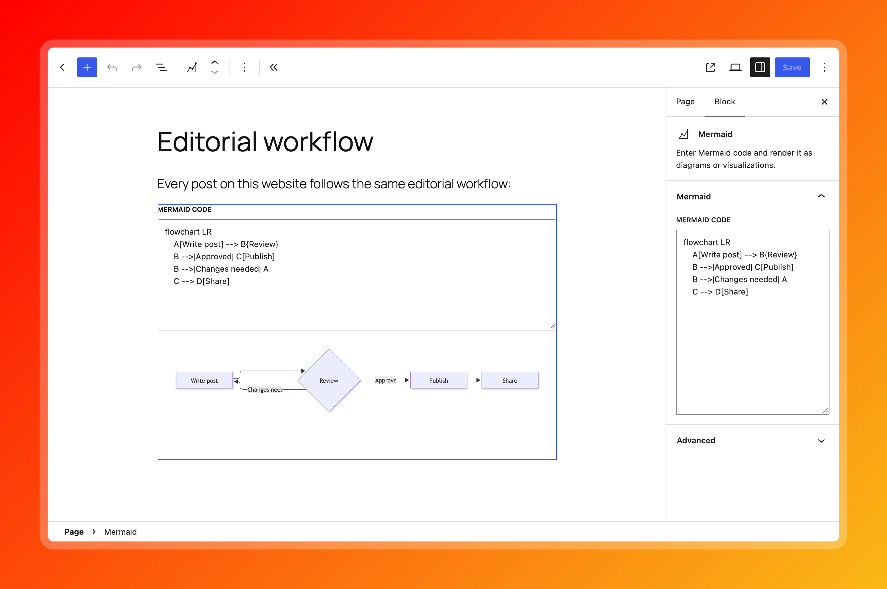
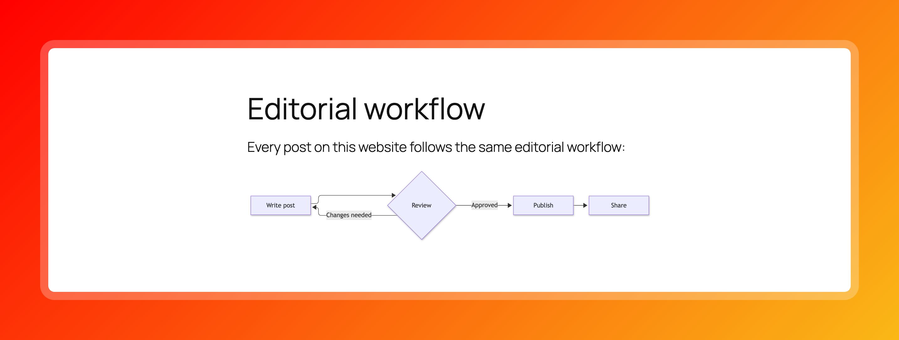
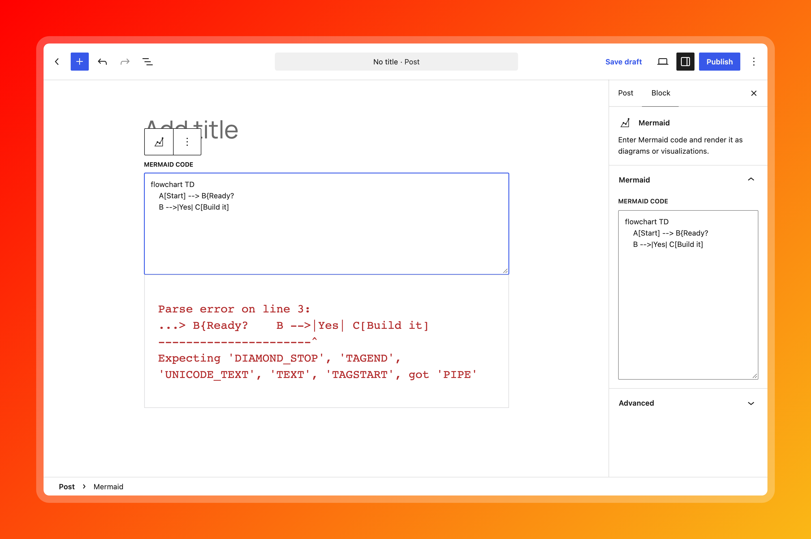

# SolveBeam Diagrams with Mermaid

[](https://github.com/solvebeam/solvebeam-diagrams-with-mermaid-for-wordpress/releases/latest)
[](https://wordpress.org/plugins/solvebeam-diagrams-with-mermaid/)
[](https://www.php.net/)
[](https://wordpress.org/)
[](https://www.gnu.org/licenses/gpl-2.0.html)
[](https://mermaid.js.org/)
[](https://playground.wordpress.net/?blueprint-url=https://raw.githubusercontent.com/solvebeam/solvebeam-diagrams-with-mermaid-for-wordpress/main/.wordpress-org/blueprints/blueprint.json)

A plugin for rendering Mermaid diagrams and visualizations from Mermaid code.

Try the plugin in [WordPress Playground](https://playground.wordpress.net/) with the Live Preview link above. The preview opens the block editor with a Mermaid diagram.



## Screenshots

| | |
|---|---|
|  |  |
|  |  |

## Requirements

- PHP 8.3+
- WordPress 6.8+
- Composer
- Node.js / npm

## Installation

```sh
composer install
npm install
```

## Development

The Mermaid block source lives in `blocks-src/mermaid-diagram/`. Build the editor and
frontend assets into `blocks/` with:

```sh
npm run build
```

Use `npm start` while developing. The block stores Mermaid code in the
post and renders a live preview in the block editor and as an SVG on the
frontend.

`blocks-src/`, `package.json`, and `composer.json` are intentionally not excluded by
`.distignore`, so the human-readable source and build tooling ship inside the
distributed plugin ZIP itself, not just in this git repository.

### Local environment (wp-env)

```sh
npx wp-env start
npx wp-env stop
```

The `.wp-env.json` maps the plugin twice into the WordPress environment:

| Mount path | Source | Purpose |
|---|---|---|
| `wp-content/plugins/solvebeam-diagrams-with-mermaid-dev` | `./` | Live development (including dev files) |
| `wp-content/plugins/solvebeam-diagrams-with-mermaid` | `./build/solvebeam-diagrams-with-mermaid/` | WordPress.org distribution build |

This lets you test both the raw source and the production build side-by-side.

### Screenshots and banner

The wordpress.org screenshots and banner in `.wordpress-org/` are generated with [Playwright](https://playwright.dev/). The plugin icon is designed by hand.

```sh
npm run build
npx playwright install chromium
npx wp-env start
npm run screenshots
npm run screenshots:assets
```

`npm run screenshots` creates the editor and frontend screenshots in `build/screenshots/` and frames them on a red to yellow gradient in `.wordpress-org/`. The numbers match the `== Screenshots ==` section in `readme.txt`. `npm run screenshots:assets` renders the banner and does not need WordPress. The scripts and test content are in `scripts/screenshots/`.

If `wp-env` runs on another port, set `WP_BASE_URL`, for example `WP_BASE_URL=http://localhost:8890 npm run screenshots`.

### Build

```sh
composer run build
```

This creates both distribution variants after one shared preparation step:

| Variant | Composer script | Archive | Translations |
|---|---|---|---|
| WordPress.org | `composer run build:wordpress-org` | `build/solvebeam-diagrams-with-mermaid.{version}.zip` | Excludes the complete `languages/` directory; translations are provided by WordPress.org language packs. |
| Standalone | `composer run build:standalone` | `build/solvebeam-diagrams-with-mermaid-standalone.{version}.zip` | Includes the POT, PO, and compiled MO files for installations outside WordPress.org. |

Both archives extract to the `solvebeam-diagrams-with-mermaid/` plugin directory. The prepared WordPress.org and standalone trees remain available in `build/solvebeam-diagrams-with-mermaid/` and `build/solvebeam-diagrams-with-mermaid-standalone/` respectively.

### Translations

Use the existing i18n scripts to keep translation files in sync:

```sh
composer run make-pot
```

This rebuilds the standalone distribution, copies its generated language files back to `languages/`, and updates the PO files from the POT template.

After updating the POT/PO files, AI can be useful for filling untranslated strings in a locale file, for example:

```text
Can you translate the untranslated texts in languages/solvebeam-diagrams-with-mermaid-nl_NL.po?
```

### Linting & analysis

```sh
composer run phpcs
composer run rector
```

Optional development tools that may be useful, but are not included by default in this Mermaid plugin for now:

#### Psalm

[Psalm](https://github.com/vimeo/psalm/) can be used for static analysis. See the [Psalm documentation](https://psalm.dev/) for setup and usage.

#### Slevomat Coding Standard

[Slevomat Coding Standard](https://github.com/slevomat/coding-standard) can be used for additional PHPCS sniffs.

## Architecture & Conventions

This Mermaid plugin follows the [SolveBeam Plugin Development Guidelines](https://github.com/solvebeam). Key conventions that may not be immediately obvious:

### Why `psr-4/` instead of `src/`

WordPress plugins typically contain PHP, JavaScript, CSS, and other assets. Using `src/` for only PHP files creates ambiguity about where non-PHP source files belong. The `psr-4/` directory makes the PSR-4 autoload root explicit and prevents accidental mixing of PHP and non-PHP sources.

### Strict typing in every file

Every PHP file must start with `declare(strict_types=1);` — no exceptions.

### Flat namespace architecture

All classes live directly under a single namespace (e.g. `SolveBeam\WordPressMermaid`). No sub-namespaces, no deep folder structure. Everything goes into `psr-4/` directly.

### Minimal visibility surface

- Classes → `final` wherever possible
- Properties → `private readonly` wherever possible
- Methods → `private` wherever possible
- Only expose what *must* be public

### Singleton pattern for Plugin.php

`psr-4/Plugin.php` must be `final`, use a private constructor, and expose a single `public static function instance(): self` entry point. Hooks are registered internally from the constructor.

### Fully qualified function calls

Always call WordPress and built-in PHP functions with a fully qualified name (FQN), using a leading backslash. In namespaced code, this avoids namespace resolution and makes it clear that the global function is being called.

```php
\add_action( 'init', $this->init( ... ) );
\sprintf( 'Plugin: %s', $name );
```

### First-class callable syntax for hooks

Always use PHP 8.1+ first-class callable syntax for hook callbacks:

```php
// ✅ Correct
\add_action( 'init', $this->init( ... ) );

// ❌ Never use array syntax
\add_action( 'init', [ $this, 'init' ] );
```

### Comments

No redundant or obvious comments. Only add comments where the logic isn't self-evident.

### Distribution cleanliness

The `.distignore` file ensures development-only files (config files, build tooling, node_modules, etc.) are excluded from the production ZIP. A `.gitattributes` with `export-ignore` rules should be used to keep GitHub-generated ZIP archives clean as well.

## Directory Structure

```
solvebeam-diagrams-with-mermaid/
├── solvebeam-diagrams-with-mermaid.php   # Main plugin file (bootstrap)
├── composer.json
├── package.json
├── .wp-env.json
├── .editorconfig
├── .gitattributes
├── .distignore
├── README.md
├── CHANGELOG.md
├── phpcs.xml.dist
├── rector.php
├── psr-4/
│   └── Plugin.php              # Singleton entry point
├── languages/
├── assets/
│   ├── js/
│   └── css/
└── vendor/
```

## License

GPL-2.0-or-later
